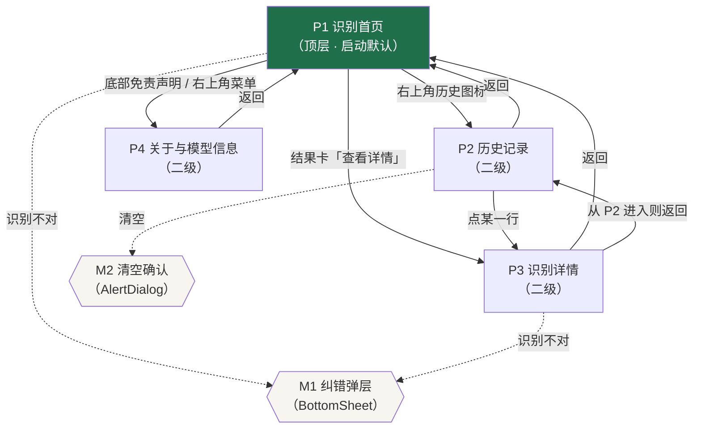

# 信息架构与页面设计

> 项目：叶片医生（植物叶片病害识别 App）
> 课程：《软件工程原理与实践》
> 版本：v1.0
> 编写：王楷宇（24020007126）
> 日期：2026-11-21
> 配套：`docs/需求规格说明.md`（需求来源）、`docs/需求调研/`（调研证据）

---

## 一、设计目标与约束

### 1.1 三条设计原则

1. **李大姐优先**（主要用户是 45 岁、非技术、田间使用）：任何一次操作不超过 2 步到结果；病害名永远是页面上最大的字；不出现专业术语。
2. **零新依赖**（三人零基础团队 + Gradle 缓存无 navigation 库）：不引入 `navigation-compose`、不引入 Retrofit/OkHttp/Coil，全部用系统 API + 现有依赖。
3. **状态可穷举**（Compose 用 `sealed interface` 表达状态，编译器强制处理每个分支）：每个页面必须写清「加载 / 空 / 错误 / 正常」四态，不允许出现未处理的状态。

### 1.2 技术约束

| 约束 | 现状 | 设计影响 |
|---|---|---|
| 无 navigation 库 | Gradle 缓存无 `androidx.navigation` | 用状态级联代替导航图 |
| 无图片加载库 | 无 Coil / Glide | 用 `BitmapFactory` + `remember` 手动加载 |
| 无 Retrofit | 无 OkHttp / Retrofit | `HttpURLConnection` 手写 multipart（已实现） |
| AGP 8.7.3 / Kotlin 2.0.21 / compose-bom 2024.12.01 | 已锁定 | 只能用该版本支持的 API（`ModalBottomSheet` 可用） |
| 项目路径含中文 | AGP 拒绝构建 | `android.overridePathCheck=true`（已加） |
| 现有配色 | LeafGreen `#1F6F4A` / Paper `#F7F5EF` / Ink `#1A1A1A` / Muted `#6B6B6B` / Warn `#B45309` / ErrRed `#B91C1C` | 沿用，不重新设计视觉语言 |

---

## 二、导航决策

### 2.1 决策：不做 Tab 导航，用「状态级联」

**候选方案对比**

| 方案 | 优点 | 缺点 | 结论 |
|---|---|---|---|
| A. BottomNavigationBar + 3 Tab | 常见、用户熟悉 | 只有 3 个页面，Tab 是过度设计；识别首页是绝对主场景，其他都是低频；多一层导航多一类 bug | ❌ 否决 |
| B. Navigation Compose + NavHost | 官方推荐、有返回栈 | 需新增依赖（缓存里没有，要联网下载）；零基础团队学路由参数又是一道坎 | ❌ 否决 |
| C. `sealed interface Screen` + `when` 整页替换 + `BackHandler` | 零依赖；状态可穷举；编译器强制处理所有分支；代码量最小 | 页面多了会失控（超过 6 个页面就该换方案） | ✅ **采纳** |

**为什么 C 在这个项目里是对的**：我们只有 4 个页面 + 2 个弹层。用方案 C 大约 40 行代码；用方案 B 要加依赖、改 Gradle、学 NavHost、处理参数序列化，至少 200 行 + 半天学习成本。**页面数是决策的关键变量**——如果将来扩到 10 个页面，必须换回 B。

### 2.2 页面清单

| 编号 | 页面名 | 层级 | 入口 | 返回行为 |
|---|---|---|---|---|
| **P1** | 识别首页 | 顶层 | 启动默认 | 系统返回键退出 App |
| **P2** | 历史记录 | 二级 | P1 右上角历史图标 | 返回 P1 |
| **P3** | 识别详情 | 二级 | P1 结果卡「查看详情」/ P2 点某一行 | 返回来源页（P1 或 P2） |
| **P4** | 关于与模型信息 | 二级 | P1 底部免责声明区 / 右上角菜单 | 返回 P1 |
| **M1** | 纠错弹层 | 弹层（BottomSheet） | P1 结果卡「识别不对」/ P3 底部 | 下滑关闭 / 点遮罩关闭 |
| **M2** | 清空历史确认 | 弹层（AlertDialog） | P2 右上角「清空」 | 点取消或确定关闭 |

**没有页面但需要的状态**：识别中（P1 内状态）、网络错误（P1 内错误卡）、权限被拒（P1 内提示）。

### 2.3 导航图



> **注**：Mermaid 在部分 PDF 导出工具里不渲染。如果报告需要 PDF，把上面这段换成下面的 ASCII 版。

**ASCII 版（PDF 安全）**

```
                        ┌─────────────────────────────┐
                        │   P1 识别首页（顶层）        │
                        │  · 拍照 / 相册               │
                        │  · 结果卡（Top-1 + Top-3）   │
                        │  · 免责声明                  │
                        └───┬──────┬──────┬───────┬───┘
            右上角历史图标   │      │      │       │  底部免责声明
                    ┌───────┘      │      │       └────────┐
                    ▼              │      │                ▼
        ┌───────────────────┐      │      │      ┌──────────────────┐
        │ P2 历史记录        │      │      │      │ P4 关于与模型信息 │
        │ · 列表（倒序）      │      │      │      │ · 模型名/准确率    │
        │ · 清空             │      │      │      │ · 技术说明        │
        └────┬──────────┬───┘      │      │      └──────────────────┘
             │          │          │      │
     点某一行 │          │ 清空      │「查看详情」
             ▼          ▼          ▼      │
        ┌───────────────────┐  ┌──────────┐
        │ P3 识别详情        │  │ M2 清空确认│
        │ · 大图 + 结果      │  │ （对话框） │
        │ · 时间 + 反馈状态   │  └──────────┘
        └────────┬──────────┘
                 │
                 ▼  「识别不对」（P1/P3 都可触发）
        ┌───────────────────┐
        │ M1 纠错弹层        │
        │ （BottomSheet）    │
        └───────────────────┘
```

### 2.4 状态级联的实现方式

```kotlin
// 只用一个 sealed interface 表达"当前在哪个页面"
sealed interface Screen {
    data object Home : Screen
    data object History : Screen
    data class Detail(val recordId: String) : Screen
    data object About : Screen
}

// MainActivity 里
var screen by remember { mutableStateOf<Screen>(Screen.Home) }

// 整页替换，不是叠加
when (val s = screen) {
    is Screen.Home    -> HomeScreen(onOpenHistory = { screen = Screen.History }, ...)
    is Screen.History -> HistoryScreen(onBack = { screen = Screen.Home },
                                       onOpen = { screen = Screen.Detail(it) })
    is Screen.Detail  -> DetailScreen(id = s.recordId, onBack = { screen = Screen.Home })
    is Screen.About   -> AboutScreen(onBack = { screen = Screen.Home })
}

// 返回键：非首页时拦截并回首页，首页时放行（退出 App）
BackHandler(enabled = screen != Screen.Home) { screen = Screen.Home }
```

**多级钻取的坑**：`Detail` 从 `Home` 进和从 `History` 进，返回目标不同。两种解法：

- **解法 1（推荐，简单）**：`Detail` 带一个 `from: Screen` 字段，返回时 `screen = s.from`。
- 解法 2（复杂，本阶段不用）：维护一个 `List<Screen>` 当返回栈。

本阶段用解法 1：

```kotlin
data class Detail(val recordId: String, val from: Screen) : Screen
// 返回时：screen = (s as Screen.Detail).from
```

### 2.5 弹层选型（依据：弹层轻重表）

| 弹层 | 内容量 | 是否需要输入 | 选型 | 理由 |
|---|---|---|---|---|
| M1 纠错 | 两屏（先选"知道/不知道"，再选作物→病害） | 是（选择） | `ModalBottomSheet` | 内容超一屏、有选择交互，但不需要全屏 |
| M2 清空确认 | 一句话 | 否 | `AlertDialog` | 危险操作必须过确认，内容 < 一屏，用最轻的层级 |

**规则**：删除/危险操作必须过确认（M2 符合）；能用轻的不用重的（M2 用 AlertDialog 而不是 BottomSheet）。

---

## 三、设计基调（Design Tokens）

> 沿用现有配色，不重新设计视觉语言。以下 token 是从现有 `MainScreen.kt` 提取 + 补充规范。

### 3.1 颜色

| Token | 值 | 用途 | 对比度（vs Paper） |
|---|---|---|---|
| `LeafGreen` | `#1F6F4A` | 主操作按钮、品牌色、Top-1 病害名 | 5.72:1 ✅ |
| `LeafGreenDark` | `#14472F` | 按下态、深色强调 | 9.15:1 ✅ |
| `Paper` | `#F7F5EF` | 页面背景 | — |
| `Surface` | `#FFFFFF` | 卡片背景 | — |
| `Ink` | `#1A1A1A` | 主文字 | 15.8:1 ✅ |
| `Muted` | `#6B6B6B` | 次要文字、说明 | 4.83:1 ✅ |
| `Warn` | `#B45309` | 低置信度警告、注意 | 4.61:1 ✅ |
| `ErrRed` | `#B91C1C` | 错误、识别失败 | 5.94:1 ✅ |
| `Divider` | `#E5E1D8` | 分隔线 | — |

**对比度全部 ≥ 4.5:1，满足 WCAG AA**。（`Muted` 4.83 和 `Warn` 4.61 是最低的两个，不要再用更浅的灰做正文。）

### 3.2 字号

| Token | 值 | 用途 |
|---|---|---|
| `DisplayL` | 32sp / Bold | Top-1 病害名（李大姐要一眼看到） |
| `DisplayM` | 24sp / Bold | 页面主标题 |
| `Title` | 20sp / SemiBold | 卡片标题、二级页标题 |
| `Body` | 16sp / Normal | 正文、说明 |
| `BodyS` | 14sp / Normal | 次要说明、meta 行 |
| `Caption` | 12sp / Normal | 免责声明、时间戳 |

**规则**：正文最小 14sp（低于 14sp 在田间强光下看不清）；Top-1 病害名固定 32sp，是所有页面最大的字。

### 3.3 间距（三级节奏）

| 层级 | 值 | 用在哪 |
|---|---|---|
| 页面边距 | 20dp | 所有页面水平边距统一 |
| 区段间 | 24dp | 大区块之间（如"结果区"与"操作区"） |
| 卡片间 | 14dp | 相邻卡片 |
| 卡内边距 | 16dp | 卡片内文字与边框 |
| 卡内元素间 | 8dp | 卡片内标题与正文 |
| 元素内 | 4dp | 文字与图标 |

### 3.4 圆角与阴影

| 元素 | 圆角 | 阴影 |
|---|---|---|
| 卡片 | 16dp | 无（用 1dp `Divider` 边框代替） |
| 主按钮 | 14dp | 无 |
| 次按钮 | 14dp | 无 |
| 缩略图 | 10dp | 无 |
| BottomSheet | 顶部 20dp | 系统默认 |
| 图标按钮 | 圆形（50%） | 无 |

**为什么不用阴影**：模拟器 swiftshader 软渲染下阴影性能差，且扁平化更符合"工具类 App"的气质。

### 3.5 触控尺寸

- 所有可点击元素 ≥ **48dp × 48dp**（Material 最低要求，也是无障碍要求）
- 主按钮高度 **52dp**（比 48 稍大，田间戴手套也好点）
- 图标按钮视觉尺寸 24dp，但 `clickable` 区域用 `minimumInteractiveComponentSize()` 撑到 48dp

---

## 四、页面详细设计

> 每页给：ASCII 线框 + 结构说明 + 四态（加载/空/错误/正常）+ 验收标准。
> 线框宽度按 360dp 屏幕（主流千元机）设计。

---

### 4.1 P1 识别首页

**定位**：App 的绝对主场景，90% 的使用时长在这里。

**线框（空闲态）**

```
┌──────────────────────────────────────────┐
│  ← 20dp →                      [历史图标] │ ← 顶栏 56dp，无标题（品牌在下方）
│                                          │
│                                          │
│           ┌────────────────────┐         │
│           │                    │         │
│           │    [叶片图标]       │         │ ← 预览区 200dp
│           │   120dp × 120dp    │         │   空态：浅灰圆底 + 图标
│           │                    │         │
│           └────────────────────┘         │
│                                          │
│              叶片医生                     │ ← DisplayM 24sp Bold
│        拍一张叶子，看看得了什么病          │ ← BodyS 14sp Muted，居中
│                                          │
│  ┌────────────────────────────────────┐  │
│  │         📷  拍 照                  │  │ ← 主按钮 52dp 高，LeafGreen 底白字
│  └────────────────────────────────────┘  │
│  ┌────────────────────────────────────┐  │
│  │         🖼  从相册选择              │  │ ← 次按钮 52dp 高，白底 LeafGreen 边框
│  └────────────────────────────────────┘  │
│                                          │
│  ─────────────────────────────────────   │ ← Divider
│                                          │
│  本工具结果仅供参考，不能替代专业诊断。    │ ← Caption 12sp Muted，居中
│  用药请遵医嘱或咨询农技员。               │   可点击 → P4
│                                          │
└──────────────────────────────────────────┘
```

**线框（识别中）**

```
┌──────────────────────────────────────────┐
│                              [历史图标]   │
│                                          │
│           ┌────────────────────┐         │
│           │                    │         │
│           │   [已拍的照片]      │         │ ← 照片保留，不消失
│           │                    │         │
│           │                    │         │
│           └────────────────────┘         │
│                                          │
│              ⟳ 正在识别…                 │ ← 20dp 转圈 + Body
│           通常需要 1–3 秒                 │ ← BodyS Muted
│                                          │
│  ┌────────────────────────────────────┐  │
│  │         （按钮禁用，浅灰）          │  │ ← 主按钮 disabled 态
│  └────────────────────────────────────┘  │
│                                          │
│  本工具结果仅供参考…                      │
└──────────────────────────────────────────┘
```

**线框（结果态）**

```
┌──────────────────────────────────────────┐
│                              [历史图标]   │
│  ┌────────────────────────────────────┐  │
│  │  ┌──────┐                          │  │
│  │  │[照片]│  番茄 · 早疫病            │  │ ← 缩略图 72dp + DisplayL 32sp
│  │  │72×72 │  92% 可能是这个病          │  │   （Top-1 是全页最大字）
│  │  └──────┘                          │  │
│  └────────────────────────────────────┘  │
│                                          │
│  其他可能                                 │ ← Title 20sp
│  ┌────────────────────────────────────┐  │
│  │ 番茄 · 晚疫病                 5%    │  │ ← Body + Caption
│  │ 番茄 · 叶霉病                 2%    │  │
│  └────────────────────────────────────┘  │
│                                          │
│  ┌────────────────────────────────────┐  │
│  │      查看详情 ›                     │  │ ← 次按钮 → P3
│  └────────────────────────────────────┘  │
│                                          │
│  这个结果对吗？                           │ ← BodyS
│  ┌──────────────┐  ┌──────────────┐     │
│  │  👍 对的      │  │  👎 不对      │     │ ← 两个次按钮，50% 宽 → M1
│  └──────────────┘  └──────────────┘     │
│                                          │
│  ┌────────────────────────────────────┐  │
│  │        重新拍一张                   │  │ ← 主按钮
│  └────────────────────────────────────┘  │
│                                          │
│  本工具结果仅供参考…                      │
└──────────────────────────────────────────┘
```

**线框（低置信度结果态，Top-1 < 60%）**

```
┌──────────────────────────────────────────┐
│  ┌────────────────────────────────────┐  │
│  │ ⚠ 模型不太确定，建议再拍一张          │  │ ← Warn 底（10% 透明）+ Warn 文字
│  │   或咨询农技员                       │  │   视觉权重高于病害名
│  └────────────────────────────────────┘  │
│  ┌────────────────────────────────────┐  │
│  │  ┌──────┐                          │  │
│  │  │[照片]│  番茄 · 早疫病            │  │
│  │  │      │  48% 可能是这个病          │  │ ← 概率 <60%，用 Muted 色不用 LeafGreen
│  │  └──────┘                          │  │
│  └────────────────────────────────────┘  │
│  ...（其余同上）                          │
└──────────────────────────────────────────┘
```

**四态说明**

| 状态 | 触发条件 | 界面表现 | 用户能做什么 |
|---|---|---|---|
| **空/空闲** | 启动后未选图 | 图标占位 + 两个选图按钮 | 拍照 / 相册 |
| **加载** | 已选图，请求中 | 照片保留 + 转圈 + 按钮禁用 | 等待（无取消按钮，因为通常 1–3 秒） |
| **错误** | 请求失败 | 照片保留 + 错误卡（ErrRed）+ 重试按钮 | 重试 / 重新选图 |
| **正常** | 请求成功 | 结果卡 + Top-3 + 反馈行 + 重拍 | 查看详情 / 反馈 / 重拍 |

**错误态线框**

```
│  ┌────────────────────────────────────┐  │
│  │ ⚠ 网络好像不通，检查一下再试         │  │ ← ErrRed 文字，白底红边框
│  │                                    │  │
│  │  ┌──────────┐  ┌──────────┐        │  │
│  │  │  重试     │  │ 重新选图  │        │  │
│  │  └──────────┘  └──────────┘        │  │
│  └────────────────────────────────────┘  │
```

**验收标准**

- [ ] 冷启动 ≤ 2 秒看到空闲态
- [ ] 点「拍照」能调起系统相机；拒绝权限时显示引导而不是崩溃
- [ ] 选图后 3 秒内出结果（本机后端、4G 模拟）
- [ ] 识别中照片不消失
- [ ] 识别失败后照片不消失，可重试
- [ ] Top-1 病害名字号 ≥ 28sp 且是页面最大字
- [ ] Top-1 置信度 < 60% 时显示橙色警告条
- [ ] 免责声明常驻可见，不可关闭
- [ ] 所有按钮 ≥ 48dp 触控区

---

### 4.2 P2 历史记录

**定位**：低频页面，用于回看和对比。**如果调研显示用户不回看（C4），本页降级为 Could 或砍掉。**

**线框（有数据）**

```
┌──────────────────────────────────────────┐
│  ┌──┐                                    │
│  │← │  识别记录            [清空]         │ ← 二级页头：42dp 圆形返回 + 标题 + 右操作
│  └──┘  共 12 条记录                       │ ← Caption 12sp Muted
├──────────────────────────────────────────┤
│  ┌────┐  番茄 · 早疫病            92%    │ ← 列表行：缩略图 56dp + 标题 + 概率
│  │[图]│  今天 14:32 · 已反馈            │ ← meta 行 BodyS Muted
│  └────┘                                  │
├──────────────────────────────────────────┤
│  ┌────┐  苹果 · 黑星病            88%    │
│  │[图]│  今天 11:05                     │
│  └────┘                                  │
├──────────────────────────────────────────┤
│  ┌────┐  葡萄 · 叶斑病            76%    │
│  │[图]│  昨天 18:20 · 已纠错            │
│  └────┘                                  │
│                                          │
│  ...（LazyColumn 继续）                   │
└──────────────────────────────────────────┘
```

**线框（空态）**

```
┌──────────────────────────────────────────┐
│  ┌──┐                                    │
│  │← │  识别记录                           │
│  └──┘                                    │
│                                          │
│                                          │
│              ┌──────────┐                │
│              │  [历史图标] │                │ ← 64dp 浅灰圆底 + 图标
│              └──────────┘                │
│                                          │
│            还没有识别记录                  │ ← Title 20sp
│         拍一张叶子，记录会自动保存在这里     │ ← BodyS Muted，引导下一步
│                                          │
│  ┌────────────────────────────────────┐  │
│  │        去拍一张                     │  │ ← 主按钮 → 回 P1
│  └────────────────────────────────────┘  │
└──────────────────────────────────────────┘
```

**结构说明**

- **二级页头公式**：`[42dp 圆形返回按钮] [标题 + 副标题两行] [右侧操作]`
- **列表行公式**：`[56dp 缩略图] [标题 + meta 行] [右侧概率]`
- **滚动方式**：`LazyColumn`（可能超过 20 条，用 `key = recordId` 避免重组错乱）
- **分组**：按日期分组（今天 / 昨天 / 更早），用 `stickyHeader`（可选，若实现麻烦则改为在行内显示日期）

**四态说明**

| 状态 | 触发条件 | 界面表现 |
|---|---|---|
| 空 | 无任何记录 | 图标 + 「还没有识别记录」+ 「去拍一张」按钮 |
| 加载 | 从本地库读取中 | 骨架屏（3 个灰色占位行，200ms 内通常不可见） |
| 错误 | 读取失败（如存储损坏） | 「记录读取失败」+ 重试（极少发生） |
| 正常 | 有记录 | 列表，按时间倒序 |

**验收标准**

- [ ] 有 0 条记录时显示空态引导，不是白屏
- [ ] 有 1 条 / 12 条 / 100 条时都正常滚动
- [ ] 点任一行进入 P3，且 P3 返回时回到 P2（不是 P1）
- [ ] 「清空」触发 M2 确认，取消不删除
- [ ] 缩略图加载不阻塞滚动

---

### 4.3 P3 识别详情

**定位**：单条记录的完整信息 + 纠错入口。从 P1 结果卡或 P2 列表进入。

**线框**

```
┌──────────────────────────────────────────┐
│  ┌──┐                                    │
│  │← │  识别详情                           │
│  └──┘                                    │
├──────────────────────────────────────────┤
│  ┌────────────────────────────────────┐  │
│  │                                    │  │
│  │         [原图，整宽]                │  │ ← 图片区，宽高比 4:3
│  │                                    │  │
│  │                                    │  │
│  └────────────────────────────────────┘  │
│                                          │
│  番茄 · 早疫病                            │ ← DisplayL 32sp
│  92% 可能是这个病                          │ ← Body Muted
│                                          │
│  ─────────────────────────────────────   │
│                                          │
│  其他可能                                 │ ← Title 20sp
│  ┌────────────────────────────────────┐  │
│  │ 番茄 · 晚疫病                 5%    │  │
│  │ 番茄 · 叶霉病                 2%    │  │
│  └────────────────────────────────────┘  │
│                                          │
│  ─────────────────────────────────────   │
│                                          │
│  识别信息                                 │ ← Title 20sp
│  ┌────────────────────────────────────┐  │
│  │ 时间        2026-11-21 14:32       │  │ ← 键值行：左 Muted 右 Ink
│  │ 模型        resnet18               │  │
│  │ 耗时        186 ms                 │  │
│  │ 反馈        已反馈「识别错误」       │  │ ← 无反馈则显示「未反馈」
│  └────────────────────────────────────┘  │
│                                          │
│  ┌────────────────────────────────────┐  │
│  │      这个结果不对，我要纠错          │  │ ← 主按钮 → M1
│  └────────────────────────────────────┘  │
│                                          │
│  本工具结果仅供参考…                      │
└──────────────────────────────────────────┘
```

**结构说明**

- 图片整宽显示（不裁剪），下方所有信息纵向排列
- 「识别信息」用键值对表格，比句子更易扫读
- 纠错按钮是主按钮（说明这页的核心价值是纠错）

**四态说明**

| 状态 | 触发条件 | 界面表现 |
|---|---|---|
| 正常 | 记录存在 | 上述布局 |
| 空 | 记录 id 找不到（被清空后从别处进入） | 「记录不存在，可能已被删除」+ 返回按钮 |
| 加载 | 读取中 | 骨架屏 |
| 错误 | 图片文件丢失 | 图片位置显示「图片已丢失」占位，其余信息正常 |

**验收标准**

- [ ] 从 P1 进入后返回 P1；从 P2 进入后返回 P2
- [ ] 图片宽高比正确，不拉伸变形
- [ ] 已反馈的记录显示反馈状态
- [ ] 纠错按钮能打开 M1 且带入本条 `request_id`

---

### 4.4 P4 关于与模型信息

**定位**：低频页面，用于满足好奇心和课程展示（老师会看这里）。也是免责声明的完整版。

**线框**

```
┌──────────────────────────────────────────┐
│  ┌──┐                                    │
│  │← │  关于                                │
│  └──┘                                    │
├──────────────────────────────────────────┤
│                                          │
│              ┌──────────┐                │
│              │ [App 图标] │                │ ← 72dp
│              └──────────┘                │
│              叶片医生                     │ ← DisplayM
│              v0.1.0（Alpha）              │ ← BodyS Muted
│                                          │
│  ─────────────────────────────────────   │
│                                          │
│  识别模型                                 │ ← Title 20sp
│  ┌────────────────────────────────────┐  │
│  │ 模型        ResNet18               │  │
│  │ 参数量      11.2 M                 │  │
│  │ 输入尺寸    224 × 224              │  │
│  │ 可识别类别  38 种（12 种作物）       │  │
│  │ 测试集准确率 99.4%                  │  │
│  └────────────────────────────────────┘  │
│                                          │
│  训练数据                                 │
│  ┌────────────────────────────────────┐  │
│  │ PlantVillage 数据集                 │  │
│  │ 54,381 张叶片图像                    │  │
│  │ 来源：HuggingFace                   │  │
│  │ GVJahnavi/PlantVillage_dataset      │  │
│  └────────────────────────────────────┘  │
│                                          │
│  重要说明                                 │ ← Title 20sp
│  ┌────────────────────────────────────┐  │
│  │ ⚠ 本模型在实验室条件下拍摄的数据集   │  │ ← Warn 边框
│  │   上训练（单一背景、固定光照）。     │  │
│  │   在真实田间照片上准确率可能显著下降。│  │
│  │   结果仅供参考，不能替代专业诊断。   │  │
│  └────────────────────────────────────┘  │
│                                          │
│  开源与致谢                               │
│  ┌────────────────────────────────────┐  │
│  │ 网络结构  torchvision               │  │
│  │ 预训练权重 ImageNet-1K              │  │
│  │ 数据集    PlantVillage（学术公开）   │  │
│  │ 项目地址  github.com/wkylnj/...     │  │ ← 可点击
│  └────────────────────────────────────┘  │
│                                          │
└──────────────────────────────────────────┘
```

**为什么这页重要**：课程报告要展示"技术选型的诚实性"。把「模型只在实验室数据上训练」这个局限主动写在界面上，比藏着更有说服力，也是需求文档里 F11 免责声明的延伸。

**四态说明**：本页无网络请求，只有「正常」态。若模型信息从后端 `/health` 拉取，则加载失败时显示本地兜底常量。

**验收标准**

- [ ] 模型名、参数量、准确率与实际训练结果一致（99.4% / 11.2M / ResNet18）
- [ ] 局限性说明用 Warn 色边框，视觉上不能弱于其他卡片
- [ ] GitHub 链接可点击（用 `Intent.ACTION_VIEW`）

---

### 4.5 M1 纠错弹层

**定位**：把用户纠错的门槛降到最低。核心设计依据：假设 H9（从 38 类里选绝大多数人放弃）→ 必须两级筛选。

**线框（第一屏：只问"知不知道"）**

```
┌──────────────────────────────────────────┐
│                  ▔▔▔▔                    │ ← 拖拽指示条
│                                          │
│  识别结果不对？                           │ ← Title 20sp
│  告诉我们正确答案，能帮模型变准            │ ← BodyS Muted
│                                          │
│  ┌────────────────────────────────────┐  │
│  │  我知道正确的病害是什么              │  │ ← 主按钮（52dp）
│  └────────────────────────────────────┘  │
│  ┌────────────────────────────────────┐  │
│  │  我也不确定                          │  │ ← 次按钮
│  └────────────────────────────────────┘  │
│                                          │
│  （点「我也不确定」→ 只记录"识别错误"，      │
│    直接提交并关闭，不给用户负担）           │
│                                          │
└──────────────────────────────────────────┘
```

**线框（第二屏：先选作物，5 个大按钮）**

```
┌──────────────────────────────────────────┐
│  ← 返回                                   │
│                                          │
│  这是哪种作物？                           │ ← Title 20sp
│  第 1 步 / 共 2 步                        │ ← Caption Muted
│                                          │
│  ┌──────────┐  ┌──────────┐             │
│  │  🍎 苹果  │  │  🍅 番茄  │             │ ← 2 列网格，每格 88dp 高
│  └──────────┘  └──────────┘             │
│  ┌──────────┐  ┌──────────┐             │
│  │  🥔 马铃薯 │  │  🌽 玉米  │             │
│  └──────────┘  └──────────┘             │
│  ┌──────────┐  ┌──────────┐             │
│  │  🍇 葡萄  │  │  🍊 柑橘  │             │
│  └──────────┘  └──────────┘             │
│  ┌──────────┐  ┌──────────┐             │
│  │  🫑 甜椒  │  │  🍑 桃    │             │
│  └──────────┘  └──────────┘             │
│  ┌──────────┐  ┌──────────┐             │
│  │  🍓 草莓  │  │  🫘 大豆  │             │
│  └──────────┘  └──────────┘             │
│  ┌──────────┐  ┌──────────┐             │
│  │  🎃 南瓜  │  │  🍒 樱桃  │             │
│  └──────────┘  └──────────┘             │
│                                          │
└──────────────────────────────────────────┘
```

> **注**：实际是 12 种作物（38 类 ÷ 平均 3 类/作物）。上图为示例，实现时从 `classes.json` 动态生成作物列表，不硬编码。2 列网格，滚动显示。

**线框（第三屏：选具体病害，4–8 个按钮）**

```
┌──────────────────────────────────────────┐
│  ← 返回                                   │
│                                          │
│  番茄的哪种情况？                         │ ← Title 20sp
│  第 2 步 / 共 2 步                        │ ← Caption Muted
│                                          │
│  ┌────────────────────────────────────┐  │
│  │  细菌性斑点病                       │  │ ← 整宽按钮，52dp 高
│  └────────────────────────────────────┘  │
│  ┌────────────────────────────────────┐  │
│  │  早疫病                             │  │
│  └────────────────────────────────────┘  │
│  ┌────────────────────────────────────┐  │
│  │  晚疫病                             │  │
│  └────────────────────────────────────┘  │
│  ┌────────────────────────────────────┐  │
│  │  叶霉病                             │  │
│  └────────────────────────────────────┘  │
│  ┌────────────────────────────────────┐  │
│  │  斑枯病                             │  │
│  └────────────────────────────────────┘  │
│  ┌────────────────────────────────────┐  │
│  │  红蜘蛛（虫害）                     │  │
│  └────────────────────────────────────┘  │
│  ┌────────────────────────────────────┐  │
│  │  靶斑病                             │  │
│  └────────────────────────────────────┘  │
│  ┌────────────────────────────────────┐  │
│  │  健康（没有病）                     │  │
│  └────────────────────────────────────┘  │
│                                          │
└──────────────────────────────────────────┘
```

**提交后**

```
│              ┌──────────┐                │
│              │  ✓       │                │ ← 绿色对勾，48dp
│              └──────────┘                │
│            感谢你的反馈                    │ ← Title 20sp
│         这会帮我们把模型改得更准            │ ← BodyS Muted
│                                          │
│  （1.5 秒后自动关闭弹层）                  │
```

**交互流程**

```
P1/P3 点「识别不对」
    ↓
M1 第一屏：知道 / 不知道
    ├─ 选「不知道」→ 提交 is_correct=false（true_label 为空）→ 成功页 → 关闭
    └─ 选「知道」→ 第二屏
              ↓
         选作物（12 选 1）
              ↓
         选病害（该作物下 3–8 选 1）
              ↓
         提交 is_correct=false + true_label
              ↓
         成功页 → 1.5 秒后关闭
```

**四态说明**

| 状态 | 表现 |
|---|---|
| 正常 | 按上述三屏流转 |
| 加载（提交中） | 按钮内嵌 20dp 转圈，禁用重复提交 |
| 错误（提交失败） | 弹层内底部显示「提交失败，网络不好」+ 重试；**不关闭弹层**，避免用户白填 |
| 成功 | 成功页，1.5 秒后自动关闭 |

**验收标准**

- [ ] 第一屏只有两个按钮，不出现长列表
- [ ] 选作物后只显示该作物的病害（不出现 38 项）
- [ ] 「不知道」路径 2 步内完成提交
- [ ] 「知道」路径 4 步内完成（弹层→作物→病害→提交）
- [ ] 提交失败不关闭弹层，可重试
- [ ] 提交成功后 P1/P3 的反馈行更新为「已反馈」

---

### 4.6 M2 清空历史确认

**定位**：危险操作确认。依据弹层轻重表：删除必须过确认，内容 < 一屏 → `AlertDialog`。

**线框**

```
        ┌──────────────────────────────┐
        │  清空全部记录？               │ ← Title 20sp
        │                              │
        │  将删除 12 条识别记录，        │ ← Body
        │  此操作不可恢复。             │
        │                              │
        │         ┌────────┐ ┌────────┐│
        │         │  取消   │ │ 清空   ││ ← 取消=文字按钮，清空=ErrRed 文字
        │         └────────┘ └────────┘│
        └──────────────────────────────┘
```

**规则**：危险按钮用 `ErrRed` 文字色（不是填充色），避免误触；默认焦点在「取消」。

---

## 五、三条关键交互流程

### 5.1 主流程：拍照识别（李大姐的 90% 场景）

```
[打开 App]
    ↓ 0.5s
P1 空闲态：看到"拍照"大按钮
    ↓ 点拍照
[系统相机] 拍照 → 返回
    ↓
P1 识别中：照片显示 + 转圈 + "正在识别…通常需要 1–3 秒"
    ↓ 1.5s（本机后端实测 24ms，4G 网络约 300–800ms）
P1 结果态：Top-1「番茄 · 早疫病 92%」+ Top-3 + 反馈行
    ↓
[用户看结果，可能]
    ├─ 满意 → 关 App（结束）
    ├─ 想知道更多 → 点「查看详情」→ P3
    ├─ 觉得错了 → 点「不对」→ M1
    └─ 再拍一张 → 点「重新拍一张」→ 回到 P1 空闲态
```

**关键指标**：从打开 App 到看到结果，**3 步操作、5 秒内**。

### 5.2 纠错流程（小陈的场景）

```
P1/P3 → 点「识别不对」
    ↓
M1 第一屏：识别结果不对？[我知道正确的病害] [我也不确定]
    ↓ 选「我知道」
M1 第二屏：这是哪种作物？[12 个作物按钮，2 列网格]
    ↓ 选「番茄」
M1 第三屏：番茄的哪种情况？[8 个病害按钮]
    ↓ 选「早疫病」
提交中：按钮转圈
    ↓ 200ms
M1 成功页：✓ 感谢你的反馈
    ↓ 1.5s 自动关闭
P1/P3 反馈行更新为「已反馈：早疫病」
```

**关键指标**：**4 步操作、15 秒内**完成一次有效纠错（含思考时间）。

### 5.3 历史查看流程（低频）

```
P1 → 点右上角历史图标
    ↓
P2 历史列表（倒序，缩略图 + 病害名 + 时间）
    ↓ 点某一行
P3 详情（大图 + 完整信息 + 纠错入口）
    ↓ 点返回
P2（不是 P1！因为 from=History）
    ↓ 点返回
P1
```

**关键点**：P3 的返回目标由 `Detail.from` 决定，不能硬编码回 P1。

---

## 六、无障碍与文案规范

### 6.1 无障碍要求

| 项 | 要求 | 检查方式 |
|---|---|---|
| 触控区 | ≥ 48dp × 48dp | 布局检查 |
| 文字对比度 | 正文 ≥ 4.5:1，大字 ≥ 3:1 | 颜色计算（见 §3.1 表） |
| 字号 | 正文 ≥ 14sp | 代码走查 |
| 颜色不单独承载信息 | 置信度除了颜色还要有数字；错误除了红色还要有图标和文字 | 灰度截图检查 |
| 支持系统字体缩放 | 用 `sp` 不用 `dp`；1.3× 缩放下不截断 | 模拟器改字体大小 |
| 内容描述 | 所有 `Image` / `IconButton` 加 `contentDescription` | 代码走查 + TalkBack |

### 6.2 文案规范

**原则：说人话，说下一步，不说技术名词。**

| 场景 | ❌ 不要写 | ✅ 应该写 |
|---|---|---|
| 空态（历史） | 暂无数据 | 还没有识别记录，拍一张叶子就会出现在这里 |
| 空态（搜索） | 无结果 | 没有找到匹配的记录 |
| 加载中 | Loading... | 正在识别… |
| 加载中（超 3 秒） | 请稍候 | 网络有点慢，正在识别… |
| 网络错误 | IOException / 请求失败 (500) | 网络好像不通，检查一下再试 |
| 服务端错误 | Internal Server Error | 服务器出了点问题，稍后再试 |
| 权限拒绝 | 权限被拒绝 | 需要相机权限才能拍照。你也可以从相册选一张已有的照片 |
| 识别失败 | 识别失败 | 这张图没认出来，换个角度再拍一张试试 |
| 低置信度 | confidence < 0.6 | 模型不太确定，建议再拍一张或咨询农技员 |
| 免责声明 | 本系统不承担任何责任 | 本工具结果仅供参考，不能替代专业诊断。用药请遵医嘱或咨询农技员。 |
| 纠错成功 | 提交成功 | 感谢你的反馈，这会帮我们把模型改得更准 |

**禁用词清单**：`暂无数据`、`加载中`、`操作成功`、`系统错误`、`未知错误`、`Error`、`Exception`、`null`、`NaN`。

### 6.3 病害名称的展示规范

统一格式：**`作物 · 病害`**（中间用间隔号，两侧各一个空格）

| 内部标签 | 展示名 |
|---|---|
| `00_Apple_Apple_scab` | 苹果 · 黑星病 |
| `15_Orange_Haunglongbing_Citrus_greening` | 柑橘 · 黄龙病 |
| `37_Tomato_healthy` | 番茄 · 健康 |

**为什么用间隔号**：让李大姐能一眼分开"这是什么作物"和"得了什么病"。单独一个"早疫病"她可能不知道是番茄的还是马铃薯的。

---

## 七、本轮明确不做的事

| 不做 | 理由 | 什么时候做 |
|---|---|---|
| Tab 导航 | 只有 4 个页面，过度设计 | 页面 > 6 个时重新评估 |
| 深色模式 | 需要重新设计一套 token，本轮时间不够 | Beta 之后（U-12） |
| 动画/转场 | 零基础团队，动画容易做出廉价感 | 不做 |
| 骨架屏 | 加载通常 < 1 秒，骨架屏反而闪一下更难看 | 不做（用简单转圈） |
| 病害知识库（详细防治） | 涉及用药安全责任 | 不做（Won't have） |
| 端侧推理 | 见 `docs/计划.md` §2 | 不做 |
| 多语言 | 目标用户是中文用户 | 不做 |
| 自定义字体 | 增加包体积，系统字体够用 | 不做 |
| 图片编辑（裁剪/旋转） | 用户不会用，且增加复杂度 | 不做 |
| 分享到微信 | 需要微信 SDK，接入成本高 | Beta 可选 |

---

## 八、实现清单（评审通过后按此顺序做）

> 本轮只写设计，不写代码。以下为实现阶段的拆解，对应 `docs/进度分工面板.md` 的 U-09 ~ U-12。

### 8.1 必做（Alpha）

| 编号 | 任务 | 对应页面 | 预估 | 依赖 |
|---|---|---|---|---|
| I-01 | 抽出 `Screen` sealed interface + `BackHandler` | 全局 | 0.5h | 无 |
| I-02 | 抽出 `PredictionSource` 接口 + `MockPredictionSource` | 数据层 | 1h | 无 |
| I-03 | P1 首页按 §4.1 重排（Hero + 两按钮 + 免责声明） | P1 | 2h | I-01、I-02 |
| I-04 | P1 四态（空闲/加载/错误/结果）用 `when(state)` 整块替换 | P1 | 2h | I-03 |
| I-05 | 结果卡：Top-1 32sp + Top-3 列表 + 低置信度警告 | P1 | 2h | I-04 |
| I-06 | P2 历史列表（LazyColumn + 空态） | P2 | 2h | I-01 |
| I-07 | P3 详情页 | P3 | 1.5h | I-01 |
| I-08 | P4 关于页 | P4 | 1h | I-01 |
| I-09 | M1 纠错弹层三屏流转 | M1 | 3h | I-02 |
| I-10 | M2 清空确认 | M2 | 0.5h | I-06 |
| **合计** | | | **15.5h** | 约 2 个工作日 |

### 8.2 可延后（Beta）

| 编号 | 任务 | 说明 |
|---|---|---|
| I-11 | 本地持久化（Room 或文件 JSON） | 支撑历史功能，需要额外依赖或手写 |
| I-12 | 反馈失败本地暂存 + 下次重试 | 提升可靠性 |
| I-13 | 深色模式 | U-12 |
| I-14 | 分享结果 | 可选 |

### 8.3 依赖关系图

```
I-01 (Screen 状态机) ──┬─→ I-03 ─→ I-04 ─→ I-05
                       ├─→ I-06 ─→ I-10
                       ├─→ I-07
                       └─→ I-08
I-02 (数据源抽象) ─────┬─→ I-03
                       └─→ I-09

I-11 (持久化) ─→ I-06 的真实数据（I-06 可先用内存列表 + 假数据）
```

**关键路径**：I-01 → I-03 → I-04 → I-05（共 6.5h），这条链不完成，Alpha 演示就没有可看的界面。

---

## 九、设计评审检查表

> 评审时逐条过，任何一条不过就退回修改。

| # | 检查项 | 通过标准 | 状态 |
|---|---|---|---|
| 1 | 每个页面都有四态说明 | 加载/空/错误/正常都有明确描述 | ☐ |
| 2 | 每个页面都有 ASCII 线框 | 能照着线框直接写 Compose | ☐ |
| 3 | 主流程不超过 3 步 | 拍照识别：打开→拍照→看结果 | ☐ |
| 4 | 纠错流程不超过 4 步 | 弹层→作物→病害→提交 | ☐ |
| 5 | 所有触控区 ≥ 48dp | 布局标注里写明 | ☐ |
| 6 | 文字对比度 ≥ 4.5:1 | §3.1 表已算 | ☐ |
| 7 | 无技术名词暴露给用户 | 走查 §6.2 文案表 | ☐ |
| 8 | 零新依赖 | 未引入 navigation/Retrofit/Coil | ☐ |
| 9 | 危险操作有确认 | 清空历史过 M2 | ☐ |
| 10 | 返回行为明确 | 每页写明返回目标，P3 用 `from` 字段 | ☐ |
| 11 | 有假数据模式方案 | `USE_MOCK` + `MockPredictionSource` | ☐ |
| 12 | 与需求文档对齐 | 每个页面能追到 US-xx | ☐ |

---

## 十、附录：与现有代码的差异清单

> 本轮不动代码，但要让实现者知道"改哪里"。

| 文件 | 现状 | 需要改成 |
|---|---|---|
| `ui/MainScreen.kt`（267 行） | 单 Column，无导航 | 拆成 `HomeScreen` + 抽出 `ResultCard`/`ErrorCard` 为独立组件；加 `Screen` 状态机（在 `MainActivity` 里） |
| `MainActivity.kt`（98 行） | 直接渲染 `MainScreen` | 加 `var screen by remember`、`when(screen)`、`BackHandler` |
| `ui/MainViewModel.kt`（89 行） | 直接调 `ApiClient` | 改为依赖 `PredictionSource` 接口；注入 `MockPredictionSource` 或 `RemotePredictionSource` |
| `data/Prediction.kt`（43 行） | `UiState` 五态 | 增加 `Record`（历史记录模型）、`Screen`（页面状态）；`UiState` 保留 |
| `data/ApiClient.kt`（127 行） | 已实现，可用 | 不改，只把它包进 `RemotePredictionSource` |
| `app/build.gradle.kts`（72 行） | 无 `USE_MOCK` | 加 `buildConfigField("boolean", "USE_MOCK", "true")` |
| `res/values/strings.xml`（24 行） | 少量字符串 | 按 §6.2 文案表补全所有用户可见文字（**不硬编码在 Kotlin 里**） |
| 新增 `ui/HistoryScreen.kt` | 不存在 | 按 §4.2 实现 |
| 新增 `ui/DetailScreen.kt` | 不存在 | 按 §4.3 实现 |
| 新增 `ui/AboutScreen.kt` | 不存在 | 按 §4.4 实现 |
| 新增 `ui/FeedbackSheet.kt` | 不存在 | 按 §4.5 实现三屏流转 |
| 新增 `data/PredictionSource.kt` | 不存在 | `interface` + 两个实现 |
| 新增 `data/RecordStore.kt` | 不存在 | 内存版（Alpha）→ 持久化版（Beta） |
