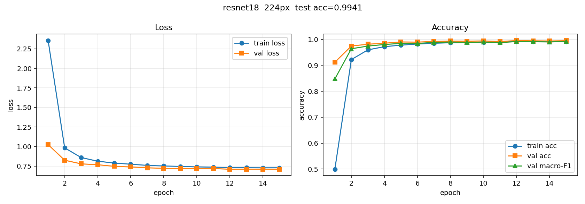
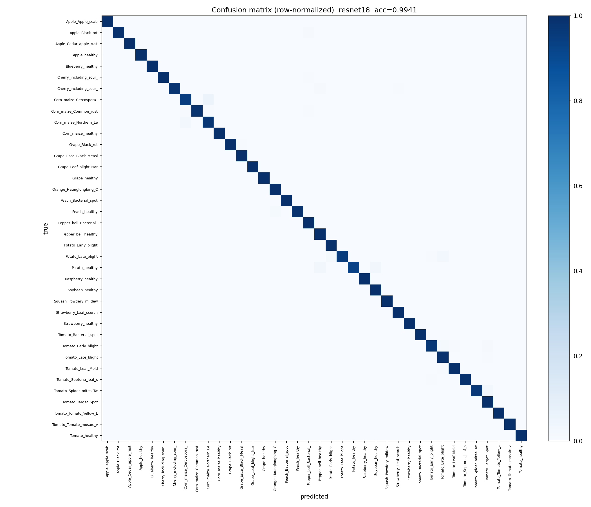
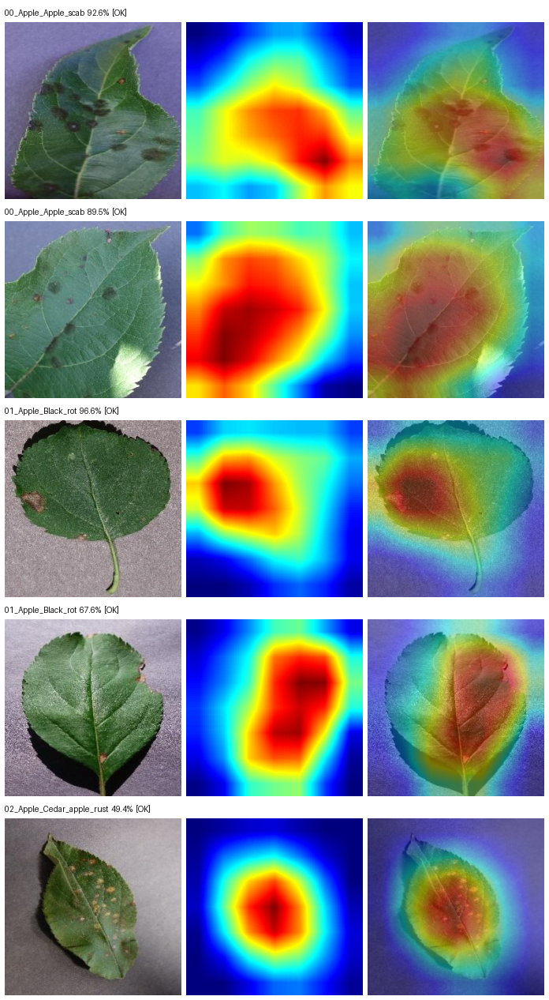
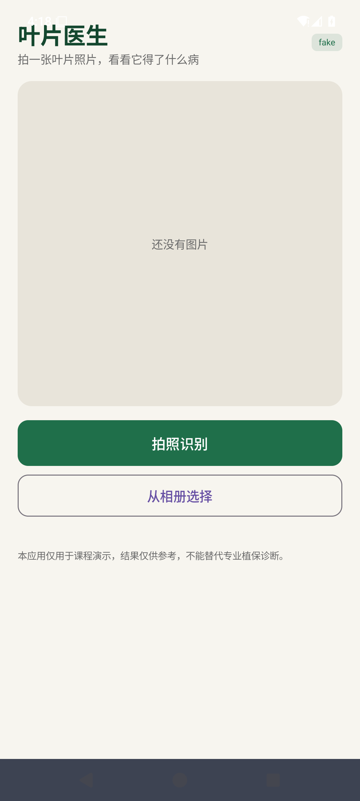
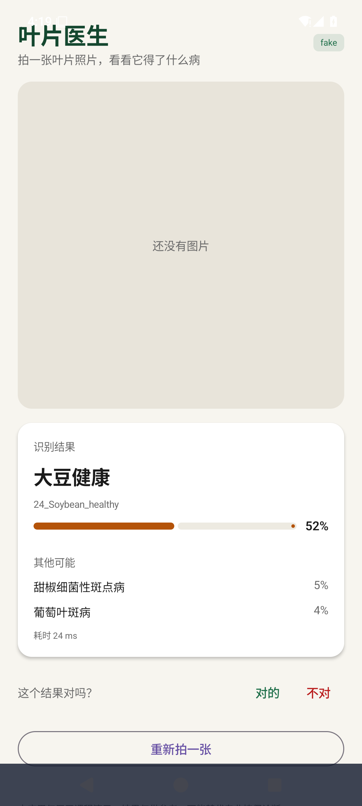
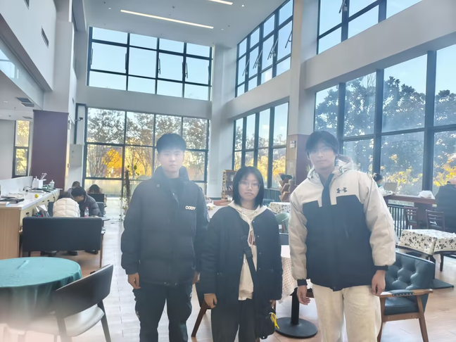

# 第 11 周周报（2026-11-15 ~ 2026-11-21）

## 一、基本情况

**团队ID**：04

**项目名称**：植物叶片病害图像识别分析系统

**组长博客**：http://124.222.157.62/

**小组 GitHub 地址**：https://github.com/wkylnj/plant-leaf-disease

**小组成员**：

| 姓名 | 角色 | 主要职责 |
|---|---|---|
| 王楷宇 | 组长 | 算法、项目管理、报告统稿 |
| 袁瑞彬 | 组员 | 后端服务与部署 |
| 芶茹蕾 | 组员 | 安卓客户端 |

**项目简介**：用户拍一张作物叶片照片，系统返回病害类别与置信度，并记录每次识别结果供后续反馈迭代。

---

## 二、冲刺概况汇报

### 2.1 王楷宇（组长）

#### 过去完成了哪些任务

**（1）数据集落地与体检。** 下载 PlantVillage（812.8 MB parquet），写脚本转为 ImageFolder 结构并分层切分，最终 38 类共 54381 张（train 39170 / val 4333 / test 10878）。体检发现**类别极不均衡，极差 36.1 倍**（橙子黄龙病 3966 张 vs 马铃薯健康 110 张），因此全项目用 macro-F1 而非 accuracy 作主指标；同时确认样本全是「单一浅色背景 + 居中单叶」，为后续跨域实验埋下伏笔。

**（2）手写特征基线。** 用 162 维手工特征（HSV 直方图 + GLCM 纹理 + Gabor）接 LogisticRegression，完全不依赖神经网络：**test acc 92.17%，训练只要 7.7 秒**。这说明任务本身不难，文献里各网络都报 99% 更多是数据集简单而非模型强，**在 PlantVillage 上比精度没有意义**——这条判断重塑了整个项目的实验方向。

**（3）算力方案。** 本机无独显，实测真实训练吞吐仅 7.1 img/s，15 轮需 23 小时。改用 Colab T4 后实测 116.8 img/s，**提升 16.5 倍**。

**（4）模型训练。** 训练期间两次被 Colab 回收会话，最终改用「一次性 run + 产物 base64 打包」方案，不再依赖会话存活。

| 模型 | 参数量 | test acc | macro-F1 |
|---|---|---|---|
| ResNet18 | 11.196 M | 99.41% | 99.16% |
| MobileNetV3-Large | 4.251 M | **99.48%** | **99.34%** |

MobileNetV3 用 ResNet18 **38% 的参数**做到更高精度，且两模型最难类高度重合（玉米灰斑病、番茄早疫病），说明难度集中在特定类而非模型容量。

**（5）E3 效率实测。** 六模型在 CPU 上测参数量、FLOPs 与延迟，发现 **EfficientNet-B0 以 0.21× 的 FLOPs 反而比 ResNet18 慢 7%**，推翻「FLOPs 低就一定快」。对手机端选型的含义是：必须实测目标硬件延迟，不能只看理论指标。

**（6）E7 Grad-CAM：预写结论被自己的数据推翻。** 方案里预写「模型看背景而非病斑」，实测 76 张后**四角注意力仅 2.7%**，假设不成立。但继续挖发现模型**也没在病斑上**：热力图是弥散大色块，健康叶与病叶注意力分布几乎一致，且注意力越分散模型反而越自信。**真实机制是模型学了「整片叶子的全局统计特征」而非「病斑的局部形态」。**

**（7）E2 跨域实验：本周最重要的成果。** 下载 PlantDoc（895.5 MB 真实田间照片），27 类映射，**不做任何微调**只换测试集：

| 模型 | 同域 | 跨域 top-1 | 作物级 |
|---|---|---|---|
| ResNet18 | 99.41% | **28.18%** | 51.13% |
| MobileNetV3 | 99.48% | **25.82%** | 51.95% |

**降 71.2 个百分点**，置信度从 0.99 掉到 0.44。作物级比病害级高 23 个百分点——**模型认得出作物、认不出病**，这与 Grad-CAM 的结论从两个独立角度互相印证。另有发现：同域 99% 区间的模型排名是噪声（MobileNetV3 同域高 0.07pp、跨域反低 2.4pp），不能据此选型。

**（8）工程交付。** 修复 ONNX 导出（缺 `onnxscript`），ResNet18 44.77 MB / MobileNetV3 16.99 MB，误差 1e-6；写命令行推理工具 `predict.py`，支持单张/批量、PyTorch/ONNX。

**（9）安卓端需求调研与设计。** 按软件工程流程补四份文档（调研总览、18 题问卷、8 问访谈提纲含假设 H1–H14、记录模板）+ 需求规格说明 v0.9（14 条 Given/When/Then 用户故事）+ 信息架构与页面设计（4 页 2 弹层，每页线框与四态）。关键判断：不做 Tab 导航（只有 4 页，会让识别首页与低频页平级），用状态级联约 40 行零依赖；纠错必须两级筛选（38 类直接给用户选会被放弃，改为先选作物再选病害）。

#### 展示当日代码/文档签入记录


2026-11-21 单日 21 次提交，覆盖模型训练、效率实测、Grad-CAM、跨域实验、ONNX 导出、安卓设计六条线。

```
aa9aad3  feat(e2): 跨域实验，PlantVillage 99.41% 到 PlantDoc 28.18%
fc8d314  feat(x02): ONNX 导出脚本，ResNet18 与 MobileNetV3 实测通过
65ac608  feat(e7): Grad-CAM 可视化，量化证明模型看全局统计而非背景
706d524  feat(e3): 六模型效率实测，参数量/FLOPs/CPU延迟三维对比
bfdda6c  feat(eval): 新增 checkpoint 补测脚本，补齐 MobileNetV3 指标
```

#### 接下来的计划

1. **域适应改进**（最高优先级）。按 E2 结论，方向不是更大模型而是域适应：强色彩/光照增强 → 背景替换 → 局部裁剪 → PlantDoc 微调。目标把跨域 top-1 从 28% 提上去。
2. **安卓端实现**。按设计文档的实现清单做，约 15.5 小时，含假数据模式便于演示。
3. **补齐实验**。手写特征消融、线性探针、错例分析、超参敏感性。
4. **真实用户测试**。问卷 ≥20 份 + 访谈 3–5 人，把需求规格补到 v1.0。

#### 还剩下哪些任务

111 项中已完成 72 项，剩余 38 项均不在 Alpha 必做清单内：Swin-T 训练（卡算力）、补齐六模型、超参敏感、多种子、消融与探针实验、后端部署系列（S-08~S-16）、安卓实现（AN-11/14、U-09~U-12、I-01~I-08）、课程报告与答辩 PPT。

#### 遇到了哪些困难

**困难一：Swin-T 因免费算力未能训练。** 尝试 4 次全部在 GPU 分配阶段失败：`ColabRequestError: ... /tun/m/assign ... Service Unavailable`。查 `colab usage` 配额正常、能开 T4，说明是免费 GPU 池无空闲实例，与代码无关。**应对**：如实写入局限，Swin-T 的效率数据已由 E3 覆盖。这也暴露了依赖免费算力的风险。

**困难二：Colab 免费版单次运行约 100 分钟上限。** 三次断连后才看出规律：ResNet18 87 分钟成功、MobileNetV3 约 95 分钟在 ep13 断、Swin-T 约 103 分钟在 ep14 断。**低于 90 分钟都成功，超过 100 分钟都失败**，问题不在用 `exec` 还是 `run` 而在总时长。**应对**：单次控制在 90 分钟内，超出则拆分续训。代价是 MobileNetV3 只保住 ep9 的 checkpoint，另写脚本做补测。

**困难三：三人对图像神经网络均为零基础。** 环境与概念理解消耗远超预期，分工只能按「谁先学什么」而非「谁擅长什么」。

**困难四：本周实际是单点推进。** 前面成果绝大部分由我一人完成，另两位队友刚完成环境配置。这是最需要正视的问题。

#### 有哪些收获和疑问

**收获**：

1. **「跑通」和「跑对」是两件事。** 冒烟测试只用 3 个 batch、精度毫无意义，但它验证了整条链路，在开训前排掉大部分环境问题。
2. **被自己的数据推翻假设是好事。** E7 原假设写得很有说服力，四角 2.7% 直接否掉它，但深挖出的「全局统计特征」解释更本质，还能同时解释 E2 的跨域崩溃——两个独立实验互相印证，比单个漂亮结论可信得多。
3. **样本量不足时容易片面。** Grad-CAM 第一次只看 6 张就以为结论定了，跑到 76 张才看清真正问题（注意力弥散）。

**疑问**：

1. **预训练权重是否被允许？** 我们用的是 ImageNet 预训练权重只换分类头微调，代码里保留了 `--no-pretrained` 开关，若不允许可切换。
2. **真实用户从哪里来？** 跨域 top-1 只有 28%，直接给种植户用不负责任。目前定位「作物识别 + 疑似病害初筛 + 明确免责」，用户先从农学院师生找。样本大概率缺真实种植户，打算如实写为研究局限。

#### 心得体会

这一周最深的感受是：**做项目和做作业是两回事。**

做作业的时候，只要最后数字好看就算过关。做项目不行，因为你要为那个数字负责。这周跑出 ResNet18 99.41% 的时候我其实兴奋了一下，但紧接着的跨域实验把这个数字打回 28.18%。如果按作业的思路，我可以只报 99.41%，没人会追究；但那样做出来的东西是假的——它在一个我从没见过的地方能用，在一个它真正该用的地方不能用。

**所以这周学到的最重要一件事，是敢于把自己的数字往难看的方向测。** 主动去找一个会让自己失败的实验（PlantDoc），这件事本身比训练出多高的精度更有价值。

第二件事是**不要相信「应该」这个词**。方案文档里我写得很顺：实验室摆拍 → 背景统一 → 模型学背景捷径 → 真实照片崩溃。这条推理链每一步单看都成立，但 Grad-CAM 一测，四角注意力只有 2.7%，整条链子塌了。我当时的第一个反应是想找理由解释为什么数据不对，后来才意识到，这就是做研究的常态——**你的假设大概率是错的，问题只在于你有没有认真去测它**。如果我只看了 6 张 Grad-CAM 就收工，我会带着一个错误结论写完整份报告，而且写得很自信。

第三件事是**组长的角色我还没转变过来**。这周几乎所有代码都是我写的，表面上看效率很高，实际上是个隐患。三个人做项目，一个人做完所有事，那另外两个人存在的意义是什么？更现实的问题是：答辩的时候老师会问每个人做了什么，队友答不上来，扣的是整组的分数。这个问题我暂时没有好的解法，但至少意识到了：**一个好的组长不是最能干的那个，是能让所有人都能干的那个**。

最后一点比较朴素的体会：**算力是会限制你的**。Swin-T 试了四次都没跑起来，不是代码写错，是免费 GPU 池排不上队。以前觉得「算力不够」是个很遥远的说法，这周算是真切体会到了——你能想到的实验，不一定有机会做。这大概也是往后做研究会一直面对的现实。

---

## 三、冲刺成果展示

### 3.1 模型训练结果

ResNet18 完整 15 轮训练曲线，第 1 轮验证精度即达 91.20%、第 2 轮跳到 97.45%——随机初始化的分类头两轮内就学会 38 类判别边界，这是迁移学习有效的直接证据。



38×38 混淆矩阵，主对角线几乎纯净。最难识别的是玉米灰斑病（F1 0.9417）、番茄早疫病（0.9576），错误集中在病斑形态相似的类别上而非随机分布。



### 3.2 Grad-CAM 可视化

每行三列分别为原图、纯热力图、叠加图。热力图是弥散的大色块，而非精确落在病斑上的小区域——模型看的是整片叶子的全局统计特征。



### 3.3 跨域实验结果

同域 99.41% → 真实田间照片 28.18%，降 71.2 个百分点。错误高度集中在视觉相似的类别对：96 次马铃薯晚疫病误判为番茄晚疫病（同为 *Phytophthora infestans*）、75 次玉米北方叶枯病误判为玉米灰斑病。**最脆弱的是「健康」类**——训练集的健康叶是干净居中单叶，真实照片是田间带土带阴影多叶，模型从没见过「脏的」健康叶片。

### 3.4 系统演示

安卓 App「叶片医生」跑通了「选图 → 上传 → 显示结果 → 反馈」完整链路。需说明：**这一步验证的是链路，不是模型效果**——后端挂的是假模型（界面角标 `fake`）。这样接口契约一旦冻结，三条线就能并行。

<table>
<tr>
<td align="center"><br><sub>(a) 首页</sub></td>
<td align="center"><br><sub>(b) 选择图片</sub></td>
<td align="center"><br><sub>(c) 识别结果</sub></td>
</tr>
</table>

技术选择：不用 CameraX 而用系统相机 Intent（CameraX 要处理生命周期、预览 Surface、对焦旋转，对零基础团队风险高）；不用 Retrofit/OkHttp 而手写 `HttpURLConnection` multipart（Gradle 离线缓存没有这两个库，手写约 60 行零依赖）；单 Activity + Compose，用 sealed interface 表达「空闲/上传中/成功/失败」，避免状态散落。

### 3.5 站立会议合照



**会议时间**：2026 年 11 月 21 日

**会议地点**：信南楼 1 楼咖啡厅

**参会人员**：王楷宇、袁瑞彬、芶茹蕾

**会议内容记录**：

1. 确认选题为「植物叶片病害图像识别分析系统」，前端形态定为安卓 App，推理放在服务端。
2. 明确三人分工（算法 / 后端 / 安卓），约定交叉备份——每人除自己的模块外还需能讲清另一个人的模块。
3. 确认本周目标：完成数据管线、模型训练、后端接口、安卓页面的最小闭环。
4. 同步本周进展：ResNet18 与 MobileNetV3 训练完成，效率实测与 Grad-CAM 完成，安卓端需求调研与页面设计文档完成。
5. 讨论三个待决问题：预训练权重政策（待问老师）、真实用户来源（计划从农学院师生入手）、Colab 免费额度是否够用（已遇 Swin-T 分配失败）。
6. 约定协作机制：每周固定一次站立会，每人每天至少一条 commit，任务从进度分工面板认领。
