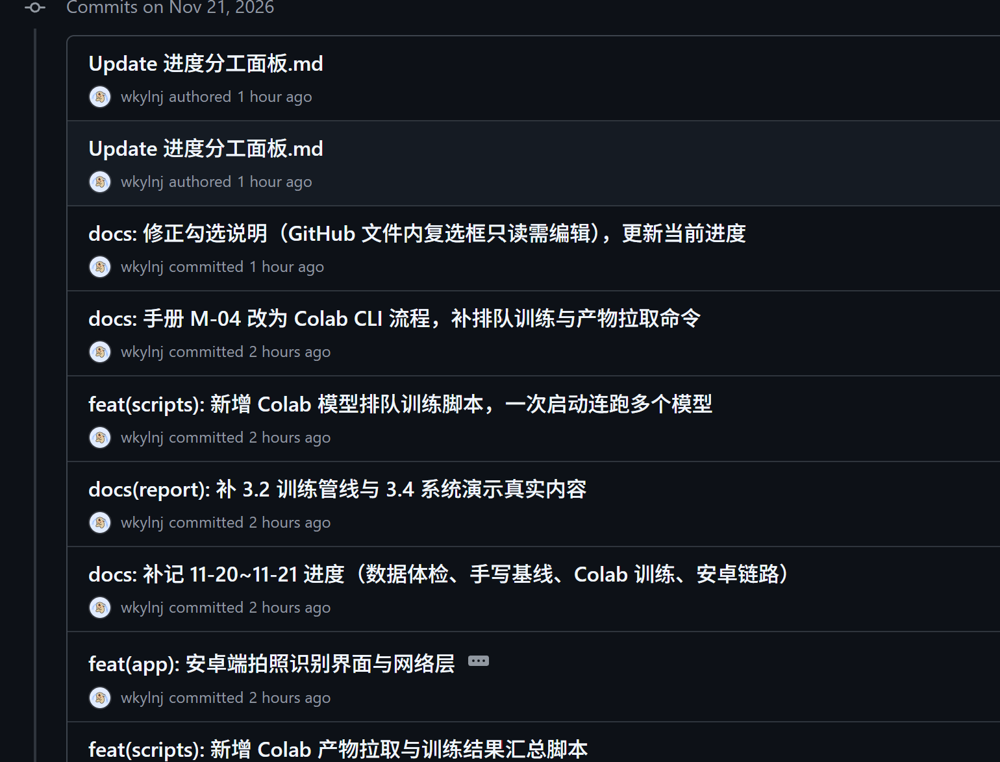
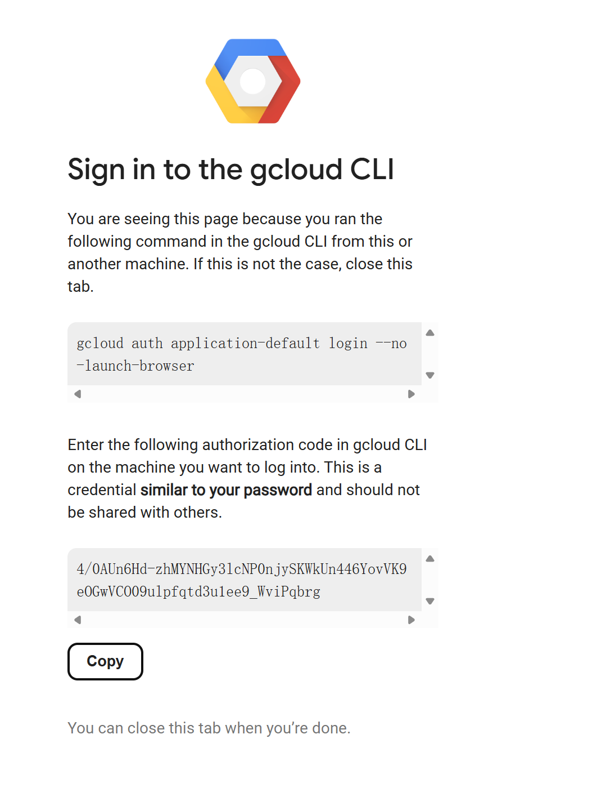
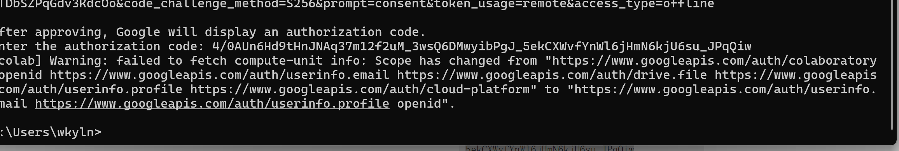

# 第 11 周周报（2026-11-15 ~ 2026-11-21）

> 项目：植物叶片病害图像识别分析系统
> 组长：王楷宇　组员：袁瑞彬、芶茹蕾
> 仓库：https://github.com/wkylnj/plant-leaf-disease

---

## 一、本周做了什么

本周是 Alpha 迭代的中段，工作量集中爆发。一句话概括：**模型训练跑通了、两篇实验做完了、安卓端从"能跑"补到了"有设计"。**

### 1. 数据集体检：先把数据看清楚

拿到 PlantVillage（54381 张、38 类）之后，没有急着训练，而是先写 `data_audit.py` 做体检。结果有三条：

- **类别极不均衡**：最多类 `15_Orange_Haunglongbing_Citrus_greening` 3966 张，最少类 `22_Potato_healthy` 110 张，**极差 36.1 倍**。
- **抽样 400 张全部是 RGB、256×256**，格式统一，不需要额外清洗。
- **背景高度一致**：抽样网格看下来，几乎都是单一浅色背景 + 居中单片叶子。

第三条是最重要的。它说明 PlantVillage 是**实验室摆拍**数据集。这个判断在后面 E7 实验里被反复用到。

### 2. 手写特征基线：证明任务本身很简单

参考 iWSP 论文（arXiv:2611.18114）的思路，用 162 维手工特征（HSV 颜色直方图 102 维 + GLCM 纹理 12 维 + Gabor 48 维）接一个 LogisticRegression。

结果：**test acc 92.17%，macro-F1 90.43%**，特征提取 1557 秒，分类器训练只要 **7.7 秒**。

这个结果的用处不是"我们也做了一个基线"，而是它改变了整个项目的实验设计方向。162 个手工数字、7.7 秒训练就能到 92%，说明这个任务本身不难。文献里各网络都报 99%，更多是任务简单而非模型强。**所以在本数据集上比精度没有意义**，我们把重心转向了跨域鲁棒性和效率对比。

### 3. 算力方案：本地 CPU 不可行，改用 Colab

先测了本机（Ryzen 7 7840HS，无独显）：

- 纯前向反向：resnet18 24.4 img/s、mobilenet_v3_large 31.2 img/s
- **真实训练实测（含数据加载与强增强）：7.1 img/s**，单轮 92 分钟，15 轮约 23 小时

23 小时不可行。改用 Google 官方 Colab CLI（`google-colab-cli` 0.8.0），从终端直接开 T4 会话，不依赖浏览器。T4 实测 **116.8 img/s**，单轮约 5.8 分钟，快了 16 倍。

### 4. 训练管线：两次会话回收后改的方案（本周最大的教训）

一开始用 `colab exec` 长连接盯训练，结果**两次被回收**：

- 第一次：MobileNetV3 跑到第 13 轮，会话没了
- 第二次：换了新会话跑 Swin-T，跑到第 3 轮又没了

`colab exec` 在免费版上长时间挂不住。第二次回收后彻底改方案：改用 `colab run`（开 VM → 跑脚本 → 释放），训练脚本自己把产物打成 base64 tar 包打到 stdout，本地脚本抓取解包。**这样产物落盘不依赖会话存活**，会话断了也不影响。

写完 `scripts/colab_train_one.py` + `scripts/colab_fetch_one.py` 之后，Swin-T 15 轮一次跑到底，没再出问题。

### 5. 模型训练结果

| 模型 | 参数量 | test acc | macro-F1 | 备注 |
|---|---|---|---|---|
| ResNet18 | 11.196M | **99.41%** | 99.16% | 完整 15 轮，有完整曲线与混淆矩阵 |
| MobileNetV3-Large | 4.251M | **99.48%** | 99.34% | 中断于第 13 轮，用第 9 轮 best.pt 补测 |

MobileNetV3 这条值得单独说：它的训练被会话回收打断了，但本地保住了第 9 轮的 `best.pt`。为此写了一个 `eval_ckpt.py`，不用重新训练就能对已有 checkpoint 做测试集评估。

结果有意思：**MobileNetV3 用 ResNet18 38% 的参数，做到了更高的精度**（99.48% vs 99.41%）。而且两个模型的最难识别类别高度一致（都是玉米灰斑病、番茄早疫病），说明**任务难度集中在特定类，不是模型选择问题**。

### 6. E3 效率实测：推翻"FLOPs 低就一定快"

六个模型全部测了参数量、FLOPs、CPU 单张延迟（224px / batch 1 / 8 线程）：

| 模型 | 参数量(M) | FLOPs(G) | 延迟(ms) | 相对 ResNet18 延迟倍数 |
|---|---|---|---|---|
| shufflenet_v2_x1_0 | 1.293 | 0.576 | 12.6 | 0.75× |
| mobilenet_v3_large | 4.251 | 0.861 | 13.6 | 0.81× |
| resnet18 | 11.196 | 7.254 | 16.7 | 1.00× |
| **efficientnet_b0** | **4.056** | **1.538** | **17.9** | **1.07×** |
| resnet50 | 23.586 | 16.349 | 42.9 | 2.56× |
| swin_t | 27.549 | 17.959 | 53.8 | 3.21× |

三条结论：

1. **参数量与延迟不成比例**。ShuffleNetV2 参数只有 ResNet18 的 12%、FLOPs 8%，但延迟只降到 75%。小模型在 CPU 上吃不满多核和向量化，瓶颈转移到内存访问与算子调度。
2. **EfficientNet-B0 是反例**。参数 0.36×、FLOPs 0.21×，延迟却是 **1.07×，比 ResNet18 还慢**。depthwise convolution + SE 模块在 CPU 上算子效率低。这直接推翻了"FLOPs 低就一定快"的直觉。
3. **Swin-T 三维全面落后**。延迟倍数 3.21× 明显高于 FLOPs 倍数 2.48%，说明注意力算子在 CPU 上效率更差（大量小矩阵乘、softmax、转置）。

### 7. E7 Grad-CAM：我们预写的结论被推翻了

这是本周最有意思的一件事。

**原假设**（写在方案文档里的结论 4）：模型看的是背景而不是病斑，这解释了为什么跨域会崩。推理链很顺：实验室摆拍 → 背景统一 → 模型学到"背景捷径" → 真实照片上崩。

做了 Grad-CAM 可视化，38 类 × 2 张共 76 张，量化统计注意力分布：

| 指标 | 实测 | 原假设预期 |
|---|---|---|
| 中心 50% 区域注意力 | 47.5% | 低 |
| **四角注意力** | **2.7%** | **应该很高** |
| 健康叶中心注意力 | 46.9% | — |
| 病叶中心注意力 | 47.7% | — |

**四角注意力只有 2.7%，模型确实没在看背景。假设不成立。**

但继续挖下去发现了更值得写的东西：**模型也没在病斑上**。

- 热力图是弥散的大色块，不是精确落在斑点上的小区域
- 健康叶（完全没病斑）和病叶的注意力分布几乎一模一样（46.9% vs 47.7%）
- **注意力越分散，模型反而越自信**（分散组 88.7% vs 集中组 85.4%）
- 有固定空间偏好，偏左上（左列 39.9% vs 右列 22.2%），这跟拍摄构图有关，跟病理无关

**真实机制：模型学的是"整片叶子的全局统计特征"（整体色调、纹理能量、明暗分布），不是"病斑的局部形态"。**

这个结论比原假设更有价值。原假设说"模型作弊看背景"，那是数据问题；新结论说"模型用了对成像条件敏感的表示方式"，那是表示问题。后者更难修，也更值得写。同时它仍然能解释跨域失效：全局统计特征对光照、色温、背景、构图高度敏感，训练测试同源时能到 99%，换成真实照片这些统计量全部漂移，模型就崩了。

### 8. 安卓端：从"能跑"补到"有设计"

上周安卓端已经能跑通全链路（拍照 → 上传 → 显示 top-3 → 反馈），但那是"能跑就行"的实现，没有需求分析、没有信息架构、没有页面设计。软件工程课要考的恰恰是这部分。

这周按软件工程流程补了四份文档：

- **需求调研 4 份**：调研总览、18 题问卷（可直接复制进问卷星）、8 问访谈提纲（每问标注要验证的假设 H1–H14）、记录模板与回收统计表。
- **需求规格说明 v0.9**：用户画像从"3 个角色标签"改成"具体的人 + 场景"（45 岁菜农李大姐、21 岁植保学生小陈），14 条用户故事全部 Given/When/Then 格式，MoSCoW 优先级 v2，需求追踪矩阵。
- **信息架构与页面设计**：导航方案三选一（BottomNav / Navigation Compose / 状态级联），最终选**状态级联**（`sealed interface Screen` + `when` + `BackHandler`，约 40 行零新依赖）。4 个页面 + 2 个弹层，每页 ASCII 线框 + 四态说明 + 验收标准。
- **进度面板同步**：U-01~U-08 全部勾选。

几个值得记的设计判断：

- **不做 Tab 导航**。只有 4 个页面，BottomNav 会让"识别首页"这个绝对主场景和其他低频页平级，反而增加操作步数。
- **纠错必须两级筛选**。38 类直接给用户选，绝大多数人会放弃。改成"先选作物（12 个）→ 再选病害（3–8 个）"，单次选择从 38 项降到 8 项以内。
- **免责声明常驻不可关闭**。弹窗会被点掉，常驻文字才是尽到告知义务。这是用药安全责任问题，不是 UI 偏好。
- **Top-1 病害名 32sp 是全页最大字**。目标用户在田间强光下看手机，概率数字是给专业人士的，字号要小于病害名。

---

## 二、本周签入记录

本周共 **27 次提交**（其中 11-21 单日 21 次），累计 105 个受控文件、Python 4373 行、Kotlin 655 行、Markdown 4929 行。

主要提交：

```
65ac608  feat(e7): Grad-CAM 可视化，量化证明模型看全局统计而非背景
706d524  feat(e3): 六模型效率实测，参数量/FLOPs/CPU延迟三维对比
5d3c030  feat(colab): 改用一次性 colab run 流程，产物直接落盘不依赖会话存活
bfdda6c  feat(eval): 新增 checkpoint 补测脚本，补齐 MobileNetV3 测试指标
90c769d  docs: README 目录补上需求调研与设计文档
fbfbea3  docs(design): 新增安卓端需求调研、需求规格与页面设计
dfd7b37  Update 进度分工面板.md                    ← 袁瑞彬
d8ec569  领个任务                                   ← 芶茹蕾
46599ee  Update 进度分工面板.md                    ← 王楷宇
c2fec6c  docs: 修正勾选说明，更新当前进度
0cf5d30  docs: 手册 M-04 改为 Colab CLI 流程
bbf33c0  feat(scripts): 新增 Colab 模型排队训练脚本
f5aabfd  docs(report): 补 3.2 训练管线与 3.4 系统演示真实内容
14322dc  docs: 补记 11-20~11-21 进度
e95531b  feat(app): 安卓端拍照识别界面与网络层
abc4a1f  feat(scripts): 新增 Colab 产物拉取与训练结果汇总脚本
2e8fbba  feat(server): 新增 FastAPI 后端、SQLite 存储与三后端推理
632894b  feat(train): 新增 Colab 自包含训练脚本
e5e5e51  docs: 新增进度分工面板，可勾选认领
bf14416  docs: 新增实验指导手册，111 个任务分 12 类可认领
```

可视化证据：







---

## 三、踩过的坑（这一节比成果更值得看）

1. **Colab CLI 授权缺 scope**。第一次授权 Google 只返回 3 个权限（profile/email/openid），缺 `colaboratory`/`cloud-platform`/`drive.file`，oauthlib 抛 `Scope has changed`，token 没写进 keyring。解法：`OAUTHLIB_RELAX_TOKEN_SCOPE=1` 先存 token，且授权页必须把**所有复选框勾上**。另外授权码一次性、约 10 分钟过期。

2. **`Get-Process python | Stop-Process` 误杀了正在跑的 Colab 训练**。远端 kernel 还在算，但本地输出流断了，拿不到结果。教训：重启本地服务必须按端口杀进程（`Get-NetTCPConnection -LocalPort 8000`），绝不按进程名批量杀。

3. **`colab exec` 长连接不可靠**。前面说过的两次会话回收，直接导致训练白跑。解决方案是改成一次性 `colab run` + 产物 base64 打包，不依赖会话存活。

4. **`datasets` 4.8.5 的 `row["image"]` 是已解码的 PIL Image**，不是 `{"bytes": ...}` 字典，按字典取会 `TypeError: 'JpegImageFile' object is not subscriptable`。

5. **AGP 拒绝含中文的项目路径**。报 `Your project path contains non-ASCII characters`。解法：`app/gradle.properties` 加 `android.overridePathCheck=true`。

6. **`cv2.imread` 读不了中文路径**（Windows），必须 `np.fromfile` + `cv2.imdecode`。

7. **PowerShell 里 `python -c "..."` 含中文或嵌套引号会报错**。写 Grad-CAM 分析脚本时踩的，必须写成脚本文件。

8. **Grad-CAM 第一次只看了 6 张就下结论**。6 张时看到"模型没看背景"，以为结论就定了。跑到 76 张才看清真正的问题是注意力弥散。样本量不足时容易得出片面结论。

---

## 四、接下来的计划（下周）

1. **Swin-T 训练收尾**（正在跑第 14 轮，今晚应该能完），补齐六模型的训练指标对照表。
2. **跨域实验 E2**：下载 PlantDoc 数据集，做 PlantVillage → PlantDoc 的跨域测试。按 E7 的结论，预期精度会大幅崩溃，这将是报告里最重要的一个实验。
3. **填完 Alpha 冲刺报告**：目前有 12 处占位（团队 ID、队友姓名学号、合照、会议记录、签入截图），截止 11-24 22:00，要先填掉。
4. **修 ONNX 导出**：缺 `onnxscript` 模块，报 `No module named 'onnxscript'`。
5. **安卓端实现**：设计文档用户评审通过后，按 `信息架构与页面设计.md` §8 的实现清单进代码（I-01~I-10，约 15.5 小时）。
6. **发问卷 + 访谈**：11-21 晚发问卷，11-22 上午访谈 3 人，数据回来后把需求规格从 v0.9 补到 v1.0。

---

## 五、还剩下哪些任务

按进度面板统计，还有这些没勾：

**模型与实验**
- M-06 MobileNetV3 对照（训练已中断，指标已补测，算基本完成）
- M-07 Swin-T 对照（训练中）
- M-08 补齐六模型（等 Swin-T）
- M-09 超参数敏感性
- M-10 多种子重复
- M-11 微调 vs 从零对照
- E-02 手写特征消融
- E-03 线性探针
- E-07 跨域测试 ← **优先级最高**
- E-09 错例分析

**数据**
- D-06 下载 PlantDoc 跨域集
- D-07 PlantDoc 类别映射表

**工程**
- X-01 写 `predict.py` 命令行工具
- X-02 导出 ONNX（卡在缺 `onnxscript`）
- X-04 ONNX 量化
- S-02~S-16 后端一系列（Alpha 阶段暂缓，先做模型）
- AN-01~AN-12 安卓实现（等设计评审）

**文档与汇报**
- R-07 填完 Alpha 报告 12 处占位 ← **截止 11-24 22:00**
- R-10 最终课程报告
- R-11 答辩 PPT
- G-05 第 2 次例会 + 拍照 + 写记录
- G-07 每周博客周记（即本篇）
- G-08 拿到团队 ID、队友姓名学号
- G-09 问老师预训练权重政策
- G-10 Beta 迭代反思

---

## 附：本周关键数字

| 指标 | 数值 |
|---|---|
| 本周提交次数 | 27 |
| 累计受控文件 | 105 |
| Python 代码 | 4373 行 |
| Kotlin 代码 | 655 行 |
| 文档 | 4929 行 / 24 份 |
| 训练产物 | 26 个（曲线、混淆矩阵、Grad-CAM 图等） |
| 最好模型精度 | MobileNetV3-Large 99.48% |
| 手写基线精度 | 92.17%（7.7 秒训练） |
| 实验完成数 | E3 效率实测、E7 Grad-CAM（2 篇分析文档） |