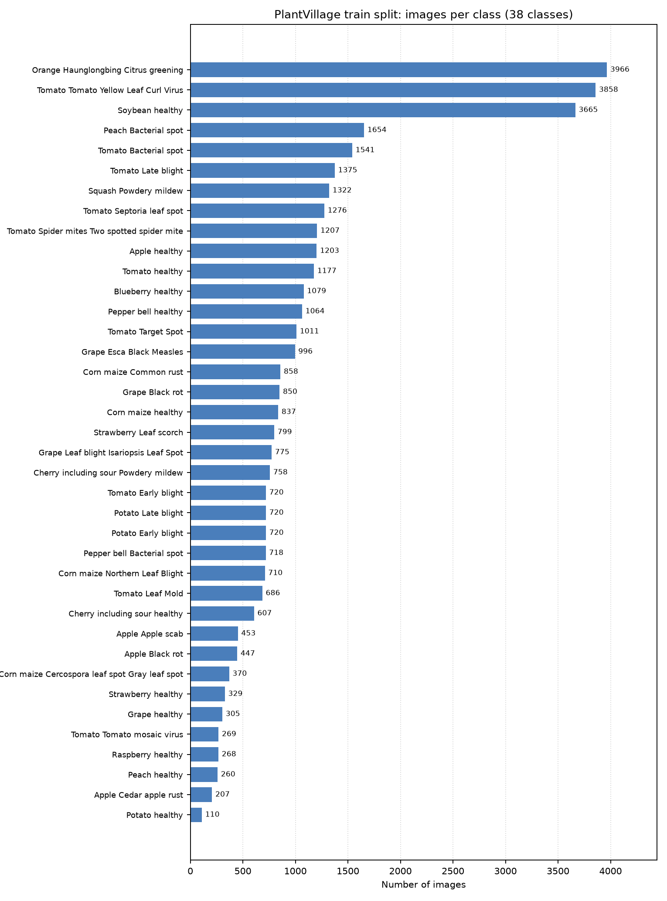
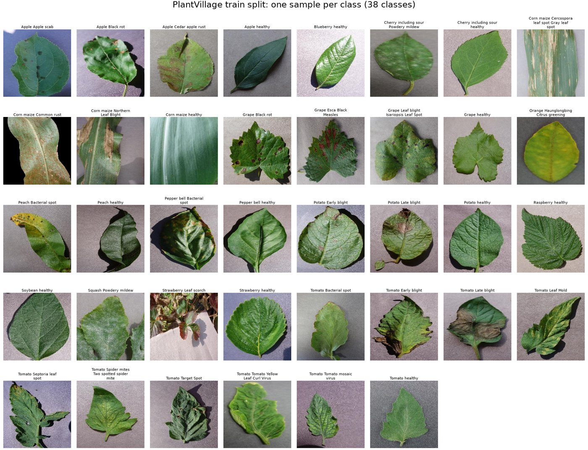

# 数据集体检报告

> 自动生成，数据根目录：`ml/data/processed/plantvillage`

## 1. 规模

| split | 类别数 | 图片数 |
|---|---:|---:|
| train | 38 | 39170 |
| val | 38 | 4333 |
| test | 38 | 10878 |
| **合计** | 38 | **54381** |

## 2. 类别一致性

三个 split 的类别集合完全一致，且目录名带两位索引前缀（如 `00_Apple_Apple_scab`），保证 `ImageFolder` 的字典序与标签整数序一一对应。

## 3. 类别不均衡

- 训练集最多类：`15_Orange_Haunglongbing_Citrus_greening`（3966 张）
- 训练集最少类：`22_Potato_healthy`（110 张）
- 极差倍数：**36.1×**
- 多数类占比：**10.1%**

**为什么必须报 macro-F1**：若模型退化成永远预测最多类，accuracy 仍有 10.1%，但 macro-F1 会接近 0。因此本项目所有实验结果同时报告 accuracy 与 macro-F1。

## 4. 图像属性（抽样）

抽样 400 张统计：

| 属性 | 取值 |
|---|---|
| 色彩模式 | RGB×400 |
| 尺寸 | 256×256 |

尺寸统一，训练时可安全使用 `RandomResizedCrop` 而不至于把病斑裁没。

## 5. 抽样网格

**观察**：背景高度一致（多为单一浅色背景、居中的单片叶子），这正是文献批评 PlantVillage 为「实验室摆拍」的直接证据——模型很容易学到背景而不是病斑。这构成本项目跨域实验（E2）与 Grad-CAM 可解释性实验（E7）的立论依据。
